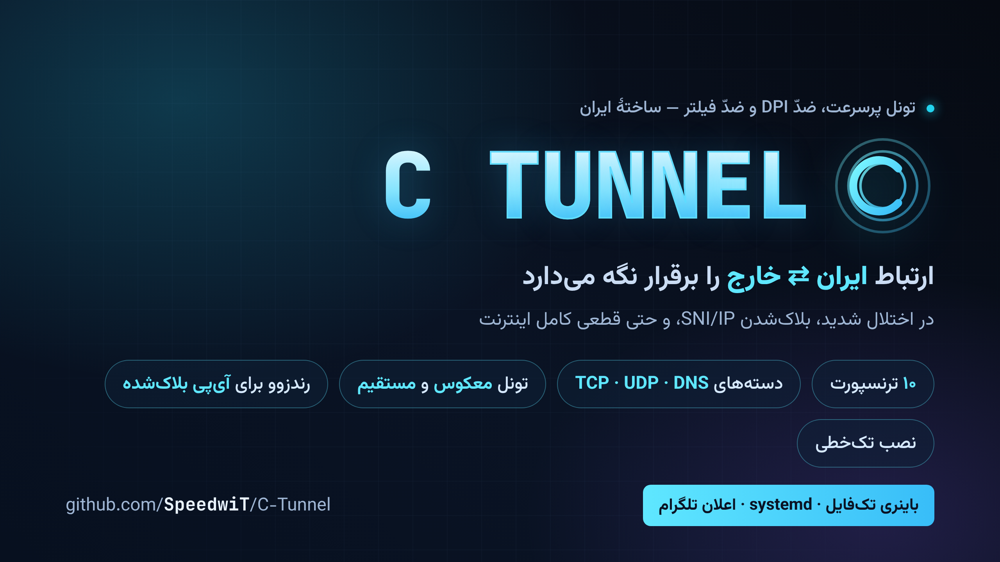
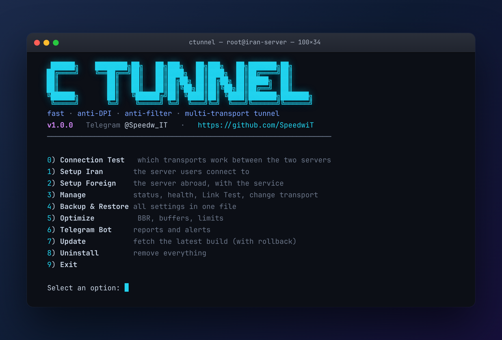
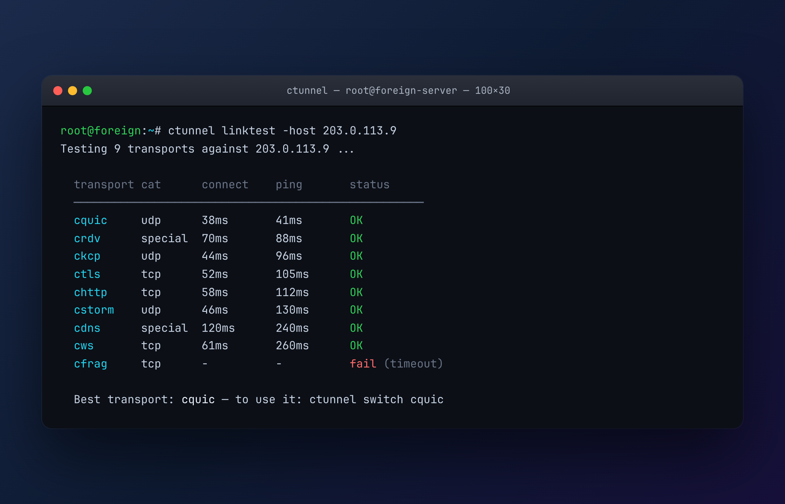

<p align="right"><a href="README.md">« English README</a></p>

<h1 align="center" id="راهنمای-فارسی">راهنمای فارسی</h1>

<p align="center">
  
</p>

<div dir="rtl">

**C Tunnel (سی‌تانل)** یک تونل پرسرعت، ضدّ DPI و ضدّ فیلتر بین یک سرور ایران (relay) و یک سرور خارج
(exit) است. برای شرایط ایران ساخته شده: اختلال شدید، packet-loss، بلاک‌شدن SNI/IP و قطعی کامل اینترنت.
یک باینری تک‌فایل Go، بدون هیچ وابستگی.

## نصب (تک‌خطی — روی هر دو سرور، اول ایران)

```bash
curl -fsSL https://raw.githubusercontent.com/SpeedwiT/C-Tunnel/main/scripts/install.sh | sudo bash
```

### نصب دستی / آفلاین (سرور ایران که دسترسی‌اش به GitHub خوب نیست)

یک **فایل آمادهٔ tar.gz** دانلود کن — از صفحهٔ [Releases](https://github.com/SpeedwiT/C-Tunnel/releases)
یا مستقیم از پوشهٔ [`dist/`](dist) — و نصبش کن. بدون Go، بدون git، بدون کامپایل.

```bash
# ۱) معماری: amd64 (اکثر سرورها) یا arm64  ->  uname -m
curl -fLO https://raw.githubusercontent.com/SpeedwiT/C-Tunnel/main/dist/ctunnel-linux-amd64.tar.gz

# ۲) باز کردن و نصب
tar -xzf ctunnel-linux-amd64.tar.gz
cd ctunnel-linux-amd64
sudo bash install.sh ./ctunnel        # ctunnel را نصب و منو را باز می‌کند
```

اگر حتی `curl` هم بسته است، فایل `.tar.gz` را روی هر دستگاهی دانلود کن و با `scp` به سرور بفرست.
راهنمای کامل گام‌به‌گام: **[docs/MANUAL_INSTALL.md](docs/MANUAL_INSTALL.md)**.

باینری را می‌سازد، `ctunnel` را نصب می‌کند و منو را باز می‌کند:

<p align="center">
  
</p>

۱. **نصب سرور ایران (Relay)** — انتخاب حالت، دستهٔ ترنسپورت و ترنسپورت، و پورت‌ها. خودش PSK می‌سازد،
کانفیگ را می‌نویسد، سرویس systemd را نصب می‌کند و یک **کد ستاپ** چاپ می‌کند.

۲. **نصب سرور خارج (Exit)** — کد ستاپ را بچسبان؛ سرور خارج در یک مرحله پیکربندی و اجرا می‌شود
(`ctunnel join <code>`).

۳. **مدیریت** — وضعیت و پینگ زنده، **Link Test**، تغییر ترنسپورت بدون نصب مجدد، اعلان تلگرام.

کد ستاپ می‌تواند **کوتاه** باشد: `‎C-Tunnel-XXXXXXXXXXXXXXXX‎` (۳۰ دقیقه معتبر، از طریق بروکر)، یا یک
کد بلندِ آفلاین و مستقل.

## دو حالت تونل

- **معکوس (Reverse):** خارج به ایران وصل می‌شود. ایران **یک پورت باز** می‌خواهد، خارج هیچ. (پیش‌فرض)
- **مستقیم (Direct):** ایران بیرون زنگ می‌زند، پس روی ایران **هیچ پورت ورودی لازم نیست**. یک تونل کامل
  IP (اینترفیس TUN + کپسولهٔ GRE داخل لایهٔ رمزنگاری Noise) برپا می‌کند تا هر دو سرور در یک شبکهٔ خصوصی
  مشترک باشند. *(انتخاب حالت، کانفیگ و جریان کد ستاپ آماده است؛ مسیر دادهٔ IP قدم بعدی است.)*

## ۱۰ ترنسپورت در دسته‌های قابل‌انتخاب

| دسته | ترنسپورت | روی شبکه شبیه چیست |
|---|---|---|
| **TCP** | ✅ `ctls` | داخل TLS 1.3 عادی (شبیه HTTPS) |
| | ✅ `cws` | وب‌سوکت روی TLS |
| | ✅ `chttp` | شبیه HTTP ساده (روی :80، در whitelistِ قطعی هم رد می‌شود) |
| | ✅ `cfrag` | فرگمنت SNI/ClientHello برای عبور از DPIِ SNI |
| | ✅ `cspoof` | **آدرس مبدأ جعلی** — هر دو دیتاسنتر باید اسپوف‌خور باشند |
| **UDP** | ✅ `cquic` | QUIC شبیه HTTP/3؛ سریع‌ترین، مهاجرت IP/پورت |
| | ✅ `ckcp` | UDP قابل‌اعتماد (KCP) با FEC؛ صاف‌کردن قطع‌وصلی |
| | ✅ `cstorm` | KCP با FEC قوی برای packet-loss شدید |
| **خاص** | ✅ `crdv` | **رندزوو** — هر دو سرور به بروکر زنگ می‌زنند (برای IP بلاک‌شده) |
| | ✅ `cdns` | **تونل DNS** (KCP روی DNS) — آخرین راه در قطعی کامل |

بدون ترنسپورت CDN — آروان/کلادفلر هر دو CDN هستند و اینجا لازم نیستند.

## وقتی یک IP بلاک است — `crdv`

اگر **IP ایران فقط از داخل ایران باز باشد** یا **IP خارج از داخل ایران فیلتر باشد**، ارتباط مستقیم در یک
جهت می‌شکند. با `crdv` **هر دو سرور بیرون زنگ می‌زنند** به یک بروکر (`ctunnel broker` روی هر هاست
قابل‌دسترسِ سوم) که آن‌ها را با یک شناسهٔ مشتق‌شده از PSK جفت می‌کند و تونلِ رمزشده را پایپ می‌کند —
هیچ‌کدام پورت ورودی لازم ندارند، پس هر طرف که بلاک باشد تونل باز می‌شود.

## وقتی همه‌چیز بلاک است — `cdns`

بررسی قطعی‌های ۲۰۲۵–۲۰۲۶ ایران نشان می‌دهد whitelistِ سانسور همچنان **DNS/HTTP/HTTPS** را رد می‌کرد و
تقریباً بقیه را می‌بست (پینگ ICMP شکست خورد). `cdns` تونل را داخل پیام‌های واقعی DNS حمل می‌کند (داده‌ها
بالا در نام کوئری، پایین در پاسخ TXT) با KCP برای قابلیت‌اطمینان. با **حالت مستقیم** استفاده کن تا ایران
کلاینتِ DNS باشد که از سرور DNSِ خارج کوئری می‌گیرد — جهتی که وقتی فقط DNS خروجی کار می‌کند دوام می‌آورد.

## Link Test

از مسیر **مدیریت ← Link Test**، همهٔ ترنسپورت‌ها تست می‌شوند (هندشیک امن واقعی + پینگ زنده) و مرتب
می‌شوند تا بهترین را انتخاب کنی — یا بدون نصب مجدد عوض کنی (`ctunnel switch <name>`).

<p align="center">
  
</p>

## قابلیت نوآورانه — مهاجرت یکپارچهٔ چندترنسپورتی

تونل‌های موجود یک ترنسپورت را ثابت می‌کنند و هنگام throttle **قطع‌ووصل** می‌شوند (همهٔ نشست‌ها می‌پرند).
لایهٔ حاملِ C Tunnel طوری ساخته می‌شود که **چند ترنسپورت را هم‌زمان** اجرا کند و **نشستِ زنده را در سطح
بسته بین آن‌ها جابه‌جا کند** — اگر یکی وسطِ کار خفه شد، ترافیک **بدون قطع تونل** روی بقیه می‌رود، با
امکان تجمیع پهنای‌باند.

## اعلان تلگرام

از **مدیریت ← اعلان تلگرام**: توکن ربات (از `@BotFather`) و آیدی چت را بده. سرور خارج رویدادهای
اتصال/قطع و وضعیت+پینگ را به چتت می‌فرستد.

## دستورها

```bash
ctunnel                       # منوی تعاملی
ctunnel setup-code -short     # (ایران) کد کوتاه ستاپ خارج
ctunnel join <code> -broker H # (خارج) پیکربندی از کد ستاپ
ctunnel broker -listen :9000  # اجرای بروکر رندزوو
ctunnel status                # نقش، حالت، پورت‌ها، پینگ زنده
ctunnel linktest -host <ip>   # (خارج) تست همهٔ ترنسپورت‌ها
ctunnel switch <transport>    # تغییر ترنسپورت بدون نصب مجدد
```

**سازنده:** SpeedwiT · **گیتهاب:** [@SpeedwiT](https://github.com/SpeedwiT)

</div>
