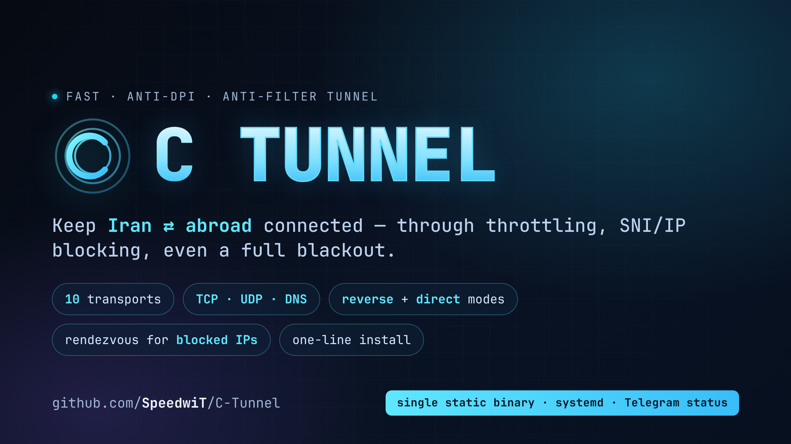
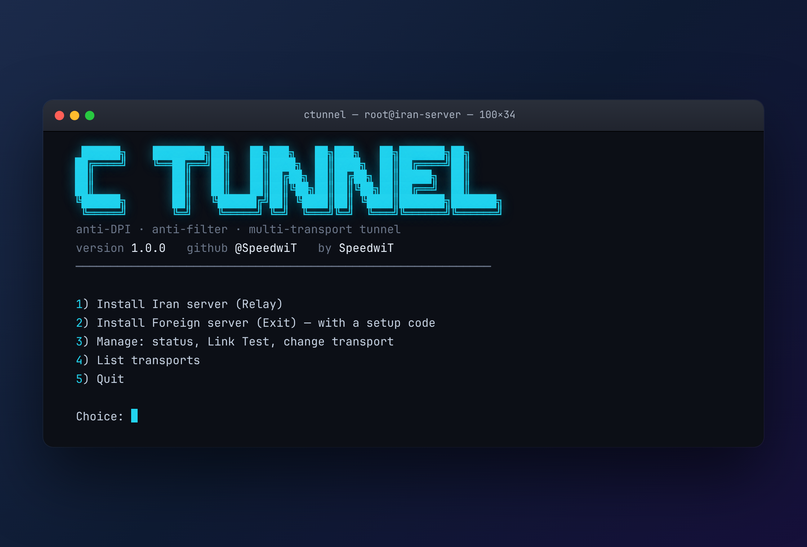
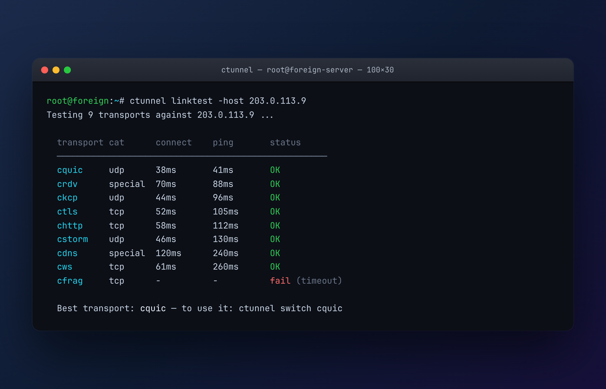

<p align="center">
  
</p>

<h1 align="center">C Tunnel</h1>

<p align="center">
  <b>A fast, anti-DPI, anti-filter, multi-transport tunnel between an Iran relay and a foreign exit.</b><br>
  Built for Iran's conditions — heavy throttling, packet loss, SNI/IP blocking, and full blackouts.
</p>

<p align="center">
  <code>10 transports</code> · <code>TCP / UDP / DNS</code> · <code>reverse + direct modes</code> ·
  <code>rendezvous for blocked IPs</code> · <code>one-line install</code> · <code>single static binary</code>
</p>

> **GitHub:** [@SpeedwiT](https://github.com/SpeedwiT) · Written in Go, no runtime dependencies.

<p align="center">
  <a href="README.fa.md"><b>🇮🇷 راهنمای کامل فارسی »</b></a>
  &nbsp;·&nbsp;
  <a href="docs/MANUAL_INSTALL.md"><b>Manual / offline install »</b></a>
</p>

---

## Install (one line — on each server, Iran first)

```bash
curl -fsSL https://raw.githubusercontent.com/SpeedwiT/C-Tunnel/main/scripts/install.sh | sudo bash
```

> On an Iran server that can't reach GitHub to build, use the
> **[manual / offline install](docs/MANUAL_INSTALL.md)**: download a prebuilt binary and run one script.

It builds the binary, installs `ctunnel`, and opens the menu:

<p align="center">
  
</p>

1. **Install Iran (Relay)** — pick mode, transport category + transport, ports. It generates the PSK,
   writes the config, installs the systemd service, and prints a **setup code**.
2. **Install Abroad (Exit)** — paste the setup code; the foreign server is configured and started in
   one step (`ctunnel join <code>`).
3. **Manage** — live status + ping, **Link Test**, change transport without reinstalling, Telegram.

The setup code can be a short, broker-backed pairing code: **`C-Tunnel-XXXXXXXXXXXXXXXX`** (valid 30
minutes), or a long self-contained offline code.

---

## How it works

```
 users ─▶ Iran relay  ══[ C Tunnel transport ]══  foreign exit ─▶ real services
```

Every transport runs under one **secure core**: an authenticated X25519 handshake keyed by a
pre-shared key, then ChaCha20-Poly1305 for confidentiality and integrity, multiplexed (yamux) so one
carrier connection serves every forwarded port. The transport's only job is to look innocuous to DPI;
it can never see or forge the traffic — so even the rendezvous broker only ever relays ciphertext.

### Two tunnel modes

- **Reverse (معکوس)** — the foreign server dials in to Iran. Iran needs **one open port**; the foreign
  server needs none. Default.
- **Direct (مستقیم)** — Iran dials **out** to the foreign server, so Iran needs **no inbound port**. It
  brings up a full L3 IP tunnel (TUN + GRE in the Noise-authenticated core) so both hosts share a
  private subnet. *(Mode selection, config and setup-code flow are in; the IP data path lands next.)*

### Transports (10, in selectable categories)

Run `ctunnel transports` to list them grouped. ✅ live & end-to-end tested, ⏳ planned.

| Category | Transport | What it looks like on the wire |
|---|---|---|
| **TCP** | ✅ `ctls` | tunnel inside ordinary TLS 1.3 (HTTPS) |
| | ✅ `cws` | WebSocket upgrade over TLS |
| | ✅ `chttp` | plain HTTP/1.1 mimic (survives the shutdown whitelist on :80) |
| | ✅ `cfrag` | ClientHello/SNI fragmentation to defeat SNI-based DPI |
| | ⏳ `cspoof` | **forged source addresses** — both datacenters must be *spoof-capable* |
| **UDP** | ✅ `cquic` | HTTP/3-shaped QUIC; fastest, migrates across IP/port |
| | ✅ `ckcp` | reliable UDP (KCP) with FEC; smooths loss |
| | ✅ `cstorm` | KCP with aggressive FEC for severe loss |
| **Special** | ✅ `crdv` | **rendezvous** — both sides dial a broker (for blocked IPs) |
| | ✅ `cdns` | **DNS tunnel** (KCP over DNS) — the blackout last resort |

No CDN transport — Cloudflare/Arvan are CDNs and aren't needed here.

### When one IP is blocked — `crdv` (rendezvous)

If the **Iran IP is reachable only domestically**, or the **foreign IP is filtered from Iran**, a direct
link fails in one direction. With `crdv`, **both servers dial OUT** to a broker (`ctunnel broker` on any
reachable third host) that pairs them by a PSK-derived id and pipes the encrypted tunnel — neither side
needs an inbound port, so whichever side is blocked, the tunnel still forms.

### When everything is blocked — `cdns` (blackout)

Measurements of Iran's 2025–2026 shutdowns show the censor's whitelist kept passing **DNS/HTTP/HTTPS**
while blocking almost everything else (ICMP ping failed). `cdns` carries the tunnel inside real DNS
messages (query names up, TXT answers down) with KCP for reliability. Pair it with **direct mode** so
Iran is the DNS *client* querying the foreign DNS server — the direction that survives when only
outbound DNS works.

### Link Test

`Manage → Link Test` probes every transport, completes the real secure handshake and times a live
ping, then ranks them so you pick the best — or switch without reinstalling (`ctunnel switch <name>`).

<p align="center">
  
</p>

### The novel bit — seamless multi-transport

Existing tunnels pin one transport and *reconnect* (dropping every session) when it's throttled. C
Tunnel's carrier layer is being built to run **several transports at once** and **migrate the live
session across them at the packet level** — if one is choked mid-stream, traffic shifts to the others
*without tearing the tunnel down*, with optional bandwidth bonding. Link Test already measures every
transport so the best set can be chosen automatically.

---

## CLI

```bash
ctunnel                       # interactive menu
ctunnel setup-code [-short]   # (Iran) print the foreign-server join code
ctunnel join <code> [-broker] # (abroad) configure from a setup code
ctunnel broker [-listen :9000]# run the rendezvous broker (any reachable host)
ctunnel status                # role, mode, forwards, live ping
ctunnel linktest-server       # (Iran) serve Link Test probes
ctunnel linktest -host <ip>   # (abroad) test every transport, ranked by ping
ctunnel switch <transport>    # change transport without reinstalling
ctunnel transports            # list transports grouped by category
ctunnel install-service       # install + start the systemd service
```

### Telegram status

Enable from **Manage → Telegram**: give a bot token (from `@BotFather`) and a chat id. The exit server
then posts connect/drop events and a status+ping heartbeat to your chat.

## Build & manual run

```bash
go build -o ctunnel ./cmd/ctunnel
ctunnel genpsk            # shared key for both configs
ctunnel run -config /etc/ctunnel/config.json
```

Relay (Iran) `config.json`:

```json
{
  "role": "relay", "mode": "reverse", "transport": "ctls", "listen": ":7000",
  "psk": "<shared key>",
  "forwards": [{ "name": "vless", "listen": 443, "target": "127.0.0.1:443" }]
}
```

Exit (abroad): `{ "role": "exit", "mode": "reverse", "transport": "ctls", "peer": "RELAY_IP:7000", "psk": "<shared key>" }`

A user connecting to `RELAY_IP:443` is tunnelled to `127.0.0.1:443` on the exit.

